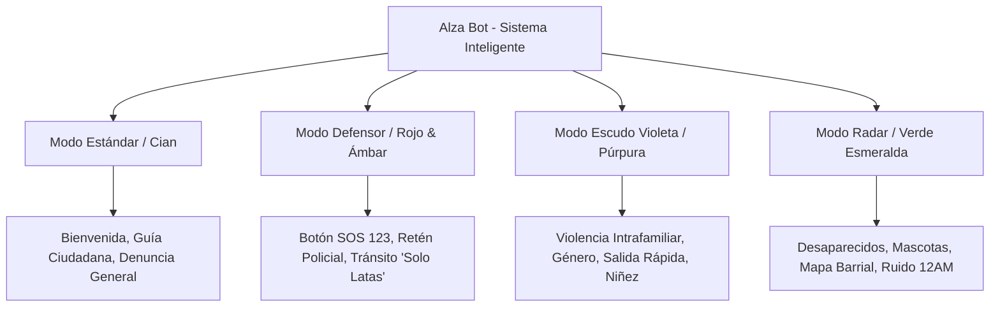

# GUÍA DE DISEÑO Y SISTEMA VISUAL: ALZAVOZ & ALZA BOT
## "UX Bajo Estrés": Principios de Diseño, Tokens y Privacidad Visual

---

## 1. Filosofía Central: UX Bajo Estrés (High-Stress UX)
*Alzavoz* no es una red social ni una aplicación convencional de trámites. Es una herramienta de **protección ciudadana, auxilio inmediato y denuncia confidencial** para los habitantes de Medellín.
Cuando un usuario interactúa con la plataforma, puede encontrarse en situaciones críticas:
- Siendo interrogado o requisado en un retén policial o de tránsito.
- Sufriendo un accidente vehicular en plena vía rápida.
- Siendo víctima o testigo de violencia intrafamiliar o extorsión.
- Desorientado o reportando una desaparición con poca señal y alta carga emocional.

### Reglas de Oro de Interacción Bajo Estrés
1. **Regla de 1 Pulgar (One-Thumb Reach):** Todos los elementos críticos (SOS, Grabar, Silencio, Salida Rápida, Enviar a WhatsApp) se concentran en el tercio inferior de la pantalla (zona natural del pulgar en smartphones).
2. **Botones Mínimos de 56px (Touch Target Fitts' Law):** Cero botones microscópicos. Los pulsadores de acción crítica miden al menos `56x56px` con espaciado generoso para evitar toques erróneos provocados por nerviosismo o temblores en las manos.
3. **Legibilidad Extrema (Ultra High Contrast):** Tipografía con pesos definidos (Medium/SemiBold/Bold), textos contrastados (>7:1 ratio WCAG AAA en datos cruciales) legibles bajo la luz solar intensa o pantallas con brillo al mínimo.
4. **Cero Fricción Cognitiva:** Formularios paso a paso (Wizard) de 1 a 2 preguntas por vista; cero captchas confusos, sin creación obligatoria de cuentas para ciudadanos.
5. **Feedback Háptico y Visual Inmediato:** Cada pulsación en botones de pánico y grabación emite confirmación visual táctil (`scale-95`, destello perimetral, vibración `navigator.vibrate([40])` si el dispositivo lo soporta).

---

## 2. Paleta de Color y Tokens de Modo Oscuro Profundo

### Fondo Base y Superficies
La interfaz opera en **Modo Oscuro Profundo (#0B0F19)** por defecto para:
- Reducir el resplandor de la pantalla en la noche (evitando que terceros noten qué hace el ciudadano).
- Maximizar la autonomía de batería en pantallas OLED durante emergencias.
- Transmitir seriedad institucional y protección tecnológica.

```css
:root {
  /* Fondos Base */
  --bg-canvas: #0B0F19;         /* Negro azulado profundo / Canvas principal */
  --bg-surface-elevated: #111827;/* Tarjetas y contenedores primarios */
  --bg-surface-glass: rgba(17, 24, 39, 0.85); /* Vidrio esmerilado con backdrop-blur */
  --bg-surface-hover: #1F2937;   /* Estados interactivos */

  /* Bordes y Líneas */
  --border-subtle: #1F2937;
  --border-focus: #374151;
  --border-glow: rgba(59, 130, 246, 0.4);

  /* Texto y Contrastes */
  --text-primary: #F9FAFB;      /* Blanco óptico puro */
  --text-secondary: #9CA3AF;    /* Gris neutro frío para etiquetas */
  --text-muted: #6B7280;        /* Gris de bajo contraste para metadatos */
  --text-inverse: #0B0F19;      /* Texto oscuro en botones luminosos */
}
```

---

## 3. Tokens Dinámicos según los 4 Modos de Alza Bot
El sistema altera dinámicamente sus acentos perimetrales, brillos (*glows*) y badges según el módulo activo, haciendo juego con la expresión de **Alza Bot**:



### Tabla de Modos y Tokens Específicos

| Modo | Tono Primario | Acento / Glow | Casos de Uso & Contexto Legal | Asset Gráfico Principal |
| :--- | :--- | :--- | :--- | :--- |
| **1. Estándar (Cian/Azul)** | `#06B6D4` / `#3B82F6` | `rgba(6, 182, 212, 0.35)` | Bienvenida, orientación cívica, radicación de inquietudes. | `Robot futurista Alza Bot con mapa holográfico.png` |
| **2. Defensor / SOS (Rojo/Ámbar)** | `#EF4444` / `#F59E0B` | `rgba(239, 68, 68, 0.45)` | Marcado 123, Ley 769 (Tránsito), Ley 1801 (Policía - Art. 21 Grabar). | `Alza Bot, Guardián de la Justicia.png` |
| **3. Escudo Violeta (Púrpura/Magenta)** | `#8B5CF6` / `#D946EF` | `rgba(139, 92, 246, 0.40)` | Violencia contra la mujer (Ley 1257), infancia (Ley 1098), Salida Rápida. | `Alza Bot_ Protección y Empatía.png` |
| **4. Radar (Verde Esmeralda)** | `#10B981` / `#059669` | `rgba(16, 185, 129, 0.35)` | Personas y mascotas perdidas, mapa barrial de comunas, sonómetro. | `Alza Bot_ Guardián de Rescate Holográfico.png` |

---

## 4. Mapeo de Activos Visuales y Expresiones de Alza Bot
Todos los archivos de imagen presentes en el proyecto han sido mapeados a ubicaciones canónicas optimizadas en `public/assets/`:

1. **`public/assets/alzabot/bot-standard.png`** (Fuente: `Robot futurista Alza Bot con mapa holográfico.png`):
   - Avatar para Header principal, chat de bienvenida y guía barrial.
2. **`public/assets/alzabot/bot-standard-scene.jpg`** (Fuente: `Gemini_Generated_Image_bfegylbfegylbfeg.jpg`):
   - Hero banner de inicio y tarjeta de presentación cívica.
3. **`public/assets/alzabot/bot-defender.png`** (Fuente: `Alza Bot, Guardián de la Justicia.png`):
   - Escudo legal con Constitución de Colombia; acompaña la asesoría en retenes de tránsito y requisas policiales.
4. **`public/assets/alzabot/bot-defender-scene.jpg`** (Fuente: `Gemini_Generated_Image_a5vk0da5vk0da5vk.jpg`):
   - Cabecera del Botón SOS y módulo de Emergencias 123.
5. **`public/assets/alzabot/bot-violet.png`** (Fuente: `Alza Bot_ Protección y Empatía.png`):
   - Ilustración empática de protección con candado y símbolo femenino; sección Escudo Violeta.
6. **`public/assets/alzabot/bot-violet-scene.jpg`** (Fuente: `Gemini_Generated_Image_noy5dxnoy5dxnoy5.jpg`):
   - Banner de soporte para Línea Púrpura y bóveda secreta de pruebas.
7. **`public/assets/alzabot/bot-radar.png`** (Fuente: `Alza Bot_ Guardián de Rescate Holográfico.png`):
   - Alza Bot de rescate con radar y retícula; tablero de desaparecidos y búsqueda de mascotas.
8. **`public/assets/alzabot/bot-radar-scene.jpg`** (Fuente: `Gemini_Generated_Image_asoju8asoju8asoj.jpg`):
   - Cabecera del generador de carteles de búsqueda comunitaria.
9. **`public/assets/brand/`**:
   - Ícono chevron estilizado extraído de la insignia de Alza Bot para `favicon.ico`, `apple-touch-icon.png` y logos PWA.

---

## 5. Reglas de Privacidad Visual y Discreción Extrema

### 1. Botón Flotante de Salida Rápida (Quick Panic Escape)
- Presente de forma persistente en los módulos sensibles (Escudo Violeta y Denuncias de Alto Riesgo).
- Al pulsar un solo toque:
  1. Redirige inmediatamente a una web inocente (`https://www.google.com` o el pronóstico del clima del IDEAM).
  2. Sustituye la entrada del historial (`window.location.replace()`) para que el botón "Atrás" del navegador no revele la denuncia.
  3. Despeja el `sessionStorage` de borradores sensibles en pantalla.

### 2. Modo Camuflaje / Desenfoque de Datos (Zero-Peeping)
- Interruptor de privacidad que aplica filtro `backdrop-filter: blur(8px)` a los nombres de calles, números de radicado ALZ-XXXX y teléfonos en pantalla.
- Se revela únicamente mientras se mantiene presionado el dedo sobre el elemento, protegiendo al ciudadano si alguien mira por encima de su hombro en un bus o calle.

---

## 6. Sistema Tipográfico y Microcopia de Acción
- **Familia Tipográfica:** Inter / System UI Sans (`system-ui, -apple-system, sans-serif`).
- **Números Tabulares:** Uso de `font-variant-numeric: tabular-nums` para marcadores de decibelios del sonómetro, contadores de grabación de la caja negra y coordenadas GPS.
- **Microcopia Firme y Respetuosa:** Textos de guía directos, sin redundancias ni tecnicismos engorrosos. 
  - *Ejemplo SOS:* *"Estás en: Cra 43A # 1-50, El Poblado. Dicta esta dirección al 123."*
  - *Ejemplo Retén:* *"Tienes derecho a grabar según el Art. 21 del Código Nacional de Policía (Ley 1801). Mantén la calma."*

